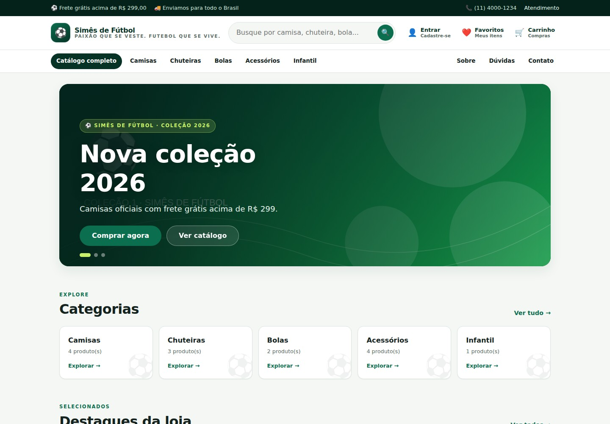

# Sites criados

Projetos de sites de Samuel Felipe Assis Nunes, desenvolvidos em trabalhos e estudos pessoais.

| Projeto | Pasta | Conteúdo |
| --- | --- | --- |
| Santos FC | [projetos/santos-fc](projetos/santos-fc/) | Site estático e versão PHP com cadastro e painel |
| Hogwarts Atlas | [projetos/hogwarts-atlas](projetos/hogwarts-atlas/) | Site temático com experiência 3D |
| Simês de Fútbol | [projetos/simes-de-futbol](projetos/simes-de-futbol/) | Projeto de loja em PHP com catálogo, carrinho e administração |

## Fotos dos projetos

### Santos FC — Alma Alvinegra

### Hogwarts — Atlas Encantado

### Simês de Fútbol

Capturas das interfaces executadas em ambiente de demonstração. A loja usa os dados de exemplo do próprio projeto.

## Como começar

- **Santos FC:** consulte o [README](projetos/santos-fc/README.md) e as [instruções da versão PHP](projetos/santos-fc/php-app/README.md). Os arquivos estáticos estão em `dist/`. Para executar a versão PHP em outro computador, instale o PHP e as extensões indicadas no README.
- **Hogwarts Atlas:** consulte o [README](projetos/hogwarts-atlas/README.md). O projeto inclui os arquivos estáticos, recursos 3D e servidor local.
- **Simês de Fútbol:** use [`.env.example`](projetos/simes-de-futbol/.env.example) como modelo para sua configuração local. O projeto contém o esquema em `database/schema.sql`, scripts de instalação em `bin/` e a entrada web em `public/`. O envio deste código não representa uma validação completa do funcionamento da loja.

## Conteúdo versionado

Os projetos estão agrupados em `projetos/`, com nomes padronizados. As capturas ficam em `docs/images/`. Imagens, estilos, scripts, código PHP, testes e créditos/licenças de recursos estão incluídos.

Credenciais locais, logs, bancos temporários, executáveis do PHP portátil e pacotes ZIP/TAR de distribuição duplicados não são versionados. As versões estáticas em `dist/` foram mantidas porque contêm os próprios sites.

Os projetos PHP precisam de um servidor PHP; o envio ao GitHub armazena o código e não configura hospedagem.

## Autor

[Samuel Felipe Assis Nunes](https://github.com/samuelfelipeassisnunes07-ux)
