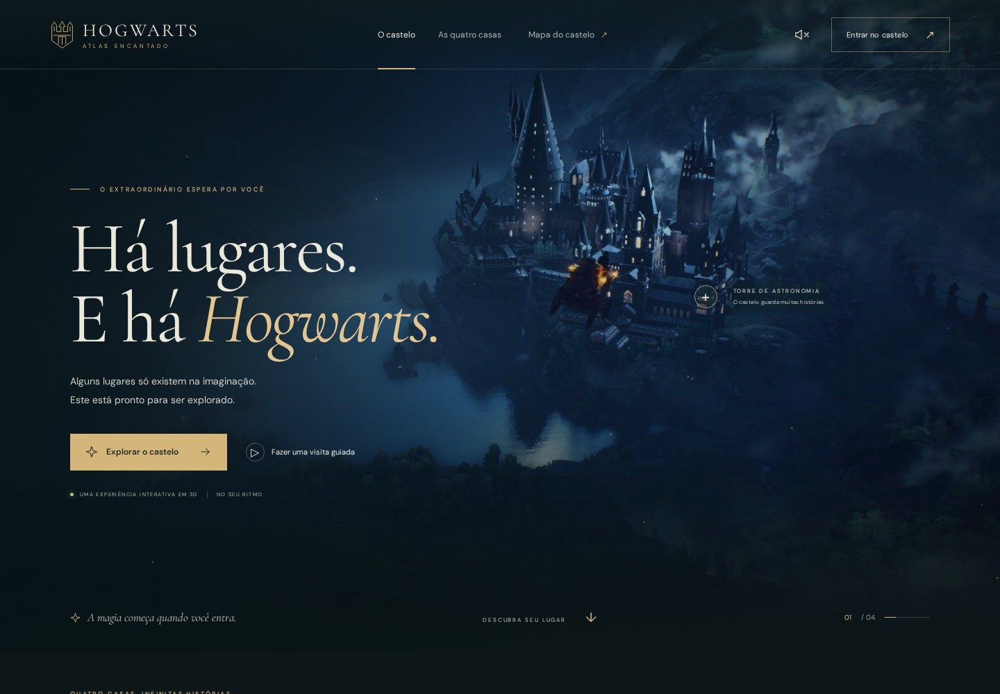

# Hogwarts — Atlas Encantado

Experiência de fã em português com sete ambientes 3D: exterior do castelo, Grande Salão, Grifinória, Sonserina, Corvinal, Lufa-Lufa e biblioteca.

## Executar

Com Node.js instalado, execute `npm start` nesta pasta e abra http://localhost:4173. O site é estático e a pasta `dist` contém todos os arquivos necessários para hospedagem. Não há instalação de dependências nem etapa de build.

## Controles

- Arraste para girar a câmera. Use a roda do mouse ou o gesto de pinça para aproximar.
- Em interiores, selecione **Caminhar**. Use WASD, as setas ou os botões na tela; arraste para olhar.
- O mapa e a barra inferior levam aos sete ambientes.
- Os marcadores revelam detalhes ou abrem outro ambiente.
- A visita guiada passa pelos sete destinos; pode ser pausada, avançada ou encerrada.
- Controles disponíveis: dia/noite, qualidade HD/ECO, restauração de câmera, tela cheia e som ambiente.
- Escape fecha uma curiosidade, sai da caminhada ou retorna ao início. O mapa possui diálogo nativo e navegação por teclado.

## Implementação e limites

Three.js 0.170.0 e OrbitControls estão incluídos localmente. Os modelos, texturas procedurais, iluminação, colisões simples e áudio são produzidos pelo código. Os ambientes são interpretações artísticas navegáveis, não reproduções exatas dos cenários dos filmes, nem um mapa contínuo de todo o castelo. O exterior usa câmera orbital; a caminhada está disponível nos seis interiores. A visita necessita de WebGL 2. A interface oferece uma mensagem de recuperação quando o renderizador não está disponível. O modo ECO reduz o custo gráfico. Animações respeitam a preferência de movimento reduzido.

## Créditos

- Imagem de abertura: imagem de Hogwarts Legacy disponibilizada em [WallpaperCat](https://wallpapercat.com/hogwarts-legacy-wallpapers), [arquivo de referência](https://wallpapercat.com/w/full/c/d/6/15645-2560x1440-desktop-hd-hogwarts-legacy-wallpaper-image.jpg). Os direitos pertencem aos respectivos titulares; uso demonstrativo nesta homenagem de fã. Substitua por uma imagem própria ou licenciada antes de eventual uso comercial.
- Three.js: licença MIT, arquivo em `dist/vendor/LICENSE-three.txt`.
- Fontes: Cormorant Garamond e DM Sans, fornecidas pelo Google Fonts, com fontes locais de sistema como fallback.
- Harry Potter, Hogwarts e seus elementos pertencem aos respectivos titulares. Projeto independente sem afiliação oficial.

A ferramenta integrada de geração de imagens foi tentada para a abertura, mas não produziu um arquivo. A imagem utilizada é a referência acima; nenhum ativo gerado foi incluído. Não foi utilizada a alternativa de CLI/API.

- Materiais de pedra e madeira: Poly Haven, Castle Brick 02 White e Wood Floor Worn, sob CC0: https://polyhaven.com/a/castle_brick_02_white e https://polyhaven.com/a/wood_floor_worn. Mapas de cor, normal e rugosidade incluídos em assets.
