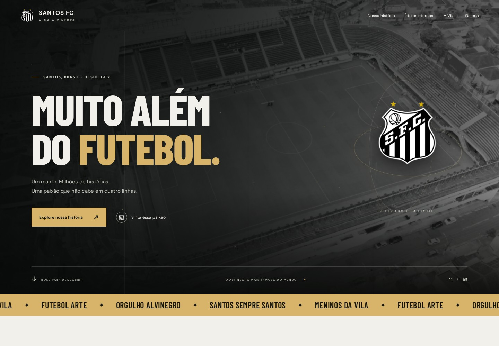

# Santos FC — Alma Alvinegra

Site estático em português, com fotos, efeitos 2D e profundidade 3D em CSS, galeria filtrável e ampliável, linha do tempo e navegação acessível. Sem dependências de build.

## Abrir localmente

Execute `python -m http.server 4173 --directory dist` nesta pasta e acesse http://localhost:4173.

Os efeitos ficam ativados automaticamente, sem controle no cabeçalho. As animações CSS respeitam a preferência de movimento reduzido do sistema. Os créditos de fotografias estão em `dist/assets/assets-sources.json` e disponíveis no rodapé.

Projeto independente de torcedor, sem vínculo oficial com o clube. Os links externos levam aos canais oficiais.
