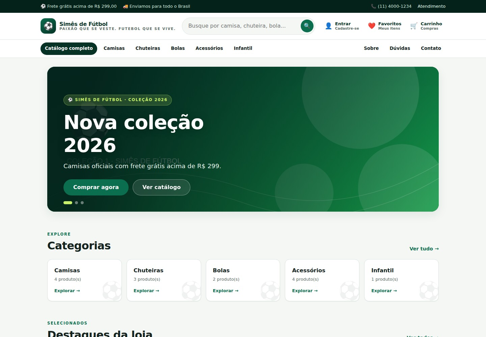

# Simês de Fútbol

Loja em PHP com catálogo, carrinho e administração.



Captura da página inicial com os produtos de demonstração fornecidos pelo projeto.

## Executar localmente

Configure o banco MySQL em `.env`, usando `.env.example` como modelo. Com PHP e as extensões necessárias instaladas:

```sh
php bin/install.php --seed
php -S 127.0.0.1:8080 -t public public/router.php
```

Abra http://127.0.0.1:8080. O instalador interativo orienta a criação do administrador. O modo de pagamento padrão é uma simulação.
